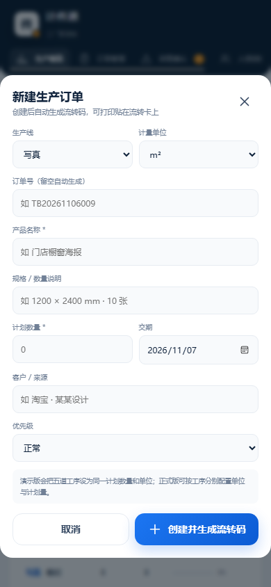
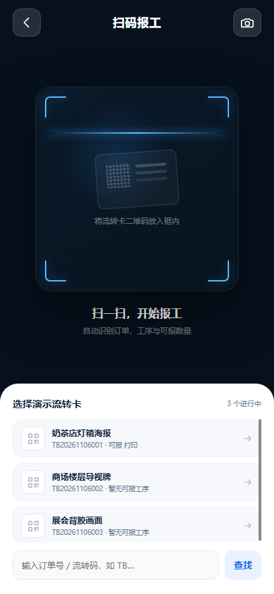
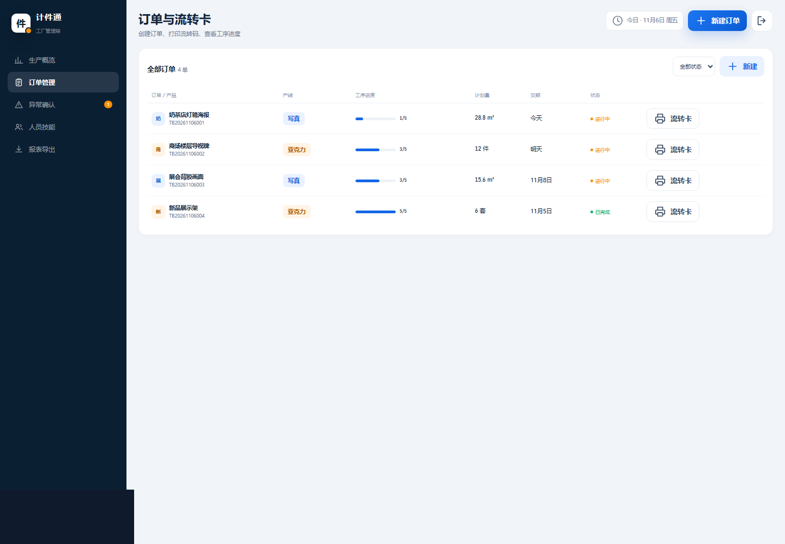
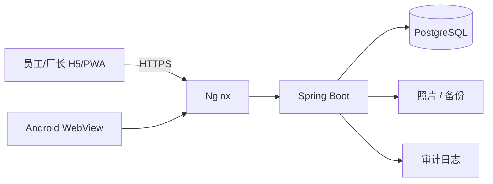

# 计件通 · 工厂计件生产管理系统

**Spring Boot 生产版** · 工厂现场计件与合报系统

[](https://github.com/wwf521xxl/jitong-spring-core/actions/workflows/ci.yml)

这个项目是我独立完成的一套工厂计件系统，从需求梳理、后端、前端、安卓端到现场部署和培训，都是我做的。

它目前在一家 17 人左右的小型工厂实际使用，覆盖写真和亚克力两条产线。系统按 50 人以内的小型工厂场景设计，重点解决三件事：

- 员工报工要快，现场没时间点很多层；
- 多人一起做的工序，数量要算得清；
- 厂长看到的是实际生产进度，不是事后补出来的表。

这个仓库是它的 **Spring Boot 生产版**：后端负责订单、报工、合报、审批和权限，前端是原生 H5/PWA，数据落在 PostgreSQL（本地演示默认 H2）。

> 系统可以独立启动、完整跑通核心流程；生产部署方式、备份和回滚见 [docs/09-生产部署.md](docs/09-生产部署.md)。

---

## 1. 为什么做这个项目

工厂原来的做法是纸单加 Excel。

员工做完一道工序，在纸上记一笔，月底再由人汇总。人少的时候还能对，人一多就出现几个问题：

- 几个人一起做同一道工序，产量算到谁头上容易有争议；
- 员工不知道自己今天做了多少，要等厂长统计；
- 订单走到哪一道，厂长只能靠问；
- 改单、补单、作废之后，历史记录对不上。

我去现场看了报工流程，发现员工真正需要的不是复杂功能，而是：

```text
扫码 → 选工序 → 报工成功
```

厂长需要的则是：

```text
订单进度、人员产量、异常记录、可追溯
```

所以这个项目从一开始就是按“现场能用”做的，不是做一个看起来完整的后台。

---

## 2. 我负责的范围

- 去工厂梳理报工、计件、合报和异常流程；
- 设计数据库表和接口；
- 写后端 API、权限、报工校验和审计；
- 写 H5/PWA 员工端和厂长端；
- 做 Android WebView 客户端和扫码；
- 处理厂内 HTTPS、证书和手机兼容；
- 打包 Windows 服务器、APK 和交付文档；
- 现场部署、培训和处理使用问题；
- 完成 Spring Boot 版：包结构、JWT 权限、合报状态机、接口契约、自动化测试、Docker/CI 和生产部署。

---

## 3. 这个版本怎么用

### 环境

- JDK 21
- Maven 3.9+（仓库自带 `mvnw`，首次运行会下载 Maven 与依赖；若 Windows 下 `mvnw` 下载失败，安装 Maven 3.9+ 后直接用 `mvn`）

### 启动

```bash
cd springboot-core
./mvnw spring-boot:run          # Windows: mvnw.cmd spring-boot:run
```

打开 <http://127.0.0.1:8080/>。

首次启动会：

- 在 `springboot-core/data/` 生成 H2 数据库；
- 执行 Flyway 建表；
- 写入演示数据：17 名员工、厂长、7 条路线、4 个订单、合报组和待审批冲销。

演示账号：

| 账号 | PIN / 密码 | 角色 | 用途 |
| --- | --- | --- | --- |
| `admin` | `Admin@123456` | 厂长 | 管理订单、结束合报、审批，但不能建单 |
| `7` | `123456` | 排版 / 多能工 | 建单、报工，演示合报开组 |
| `9` | `123456` | 过板工序 | 加入合报，演示多人平分 |
| `4` | `123456` | 普通员工 | 默认不可建单，演示权限控制 |

> 这些是演示凭据，生产环境必须通过环境变量覆盖，并关闭初始账号显示。

### 5 分钟演示路径

1. 用 `admin` 登录，看订单列表和待审批冲销；
2. 用 `7` 登录，新建一个 `m²` 订单；
3. 连续自动报工第 1、2 道；
4. 第 3 道是「写真过板」，系统会开合报组；
5. 用 `9` 登录，扫同一订单并加入合报；
6. 回到 `admin` 结束合报，两人各分一半；
7. 打开 `/api/docs` 看接口，或看 `docs/05-合报状态机.md` 理解状态迁移。

### 界面预览

系统界面如下，截图中的姓名和订单为演示数据：

| 新建订单 | 扫码报工 |
| --- | --- |
|  |  |



### PostgreSQL / Docker

```bash
docker compose -f deploy/docker-compose.yml up --build
```

或本机 PostgreSQL：

```bash
cd springboot-core
SPRING_PROFILES_ACTIVE=postgres \
JITONG_DB_URL=jdbc:postgresql://localhost:5432/jitong \
JITONG_DB_USER=jitong JITONG_DB_PASSWORD=jitong \
JITONG_JWT_SECRET='请替换为至少32字节的随机密钥' \
./mvnw spring-boot:run
```

### 常用地址

- 前端：<http://127.0.0.1:8080/>
- Swagger：<http://127.0.0.1:8080/api/docs>
- OpenAPI：<http://127.0.0.1:8080/api/openapi.json>
- 健康检查：<http://127.0.0.1:8080/api/health>

---

## 4. 技术栈与架构

| 层 | 选择 | 说明 |
| --- | --- | --- |
| Web | Spring Boot 3.5 / Spring MVC | 分层清晰，生态完整 |
| 安全 | Spring Security 6 + JJWT | 方法级权限、双令牌 |
| 数据 | Spring Data JPA + Flyway | 实体/仓储 + 版本化建表 |
| 本地演示 | H2（PostgreSQL 模式） | 零依赖启动 |
| 生产部署 | PostgreSQL | 现场数据与备份 |
| 文档 | springdoc-openapi | Swagger 在线调试 |
| 测试 | JUnit 5 + MockMvc + AssertJ | 业务规则与接口契约 |
| 部署 | Docker / GitHub Actions | 可复现构建 |



关键点：

- 前端不引入构建步骤，Spring 构建时把 `frontend/` 复制到 `static/`；
- 首页由 `FrontendController` 注入 `window.JITONG_MODE='server'`，前端不需要单独构建；
- 生产数据落在 PostgreSQL，本地演示用 H2，目录与生产数据分开。

---

## 5. 关键设计

### 5.1 订单保存路线快照，而不是引用固定工序

最早的版本把写真线写死成 5 道，亚克力线也写死一套流程。后来发现不同产品路线不一样，有的要覆膜，有的不要；有的最后要特殊加工，有的到切割就结束。只改前端不够，因为历史订单会跟着乱。

最后改成：

```text
routes / route_steps    路线模板，管理员可维护
production_jobs         订单
job_steps               创建订单时复制的工序快照
```

订单创建时把当前路线复制一份到 `job_steps`。以后管理员再改路线，只影响新订单，历史订单还是原来的工序。

### 5.2 多人合报：显式状态机，结束才结算

写真过板、写真综合、亚克力激光切割这几道工序，经常是 2～3 个人一起做。第一版想得很简单：谁扫码就给谁记一份，结果三个人扫同一道，数量被重复计算了三次。

现在的规则：

```text
第一个员工扫码 → 开组
后续员工扫码   → 加入
下一道工序开始 → 自动结束上一道
厂长完成订单   → 结束最后一道
结束时按实际人数平分
```

状态机：

```text
OPEN --JOIN--> OPEN
OPEN --BEGIN_SETTLE--> SETTLING --SETTLED--> CLOSED
OPEN --CANCEL--> CANCELLED
SETTLING --REOPEN--> OPEN
```

- 加入阶段只写参与人，不写正式产量；
- 结束合报时才一次性生成每人的 `piece_records`；
- 最后一个人补小数差额，保证总量和订单数量一致；
- 每次状态迁移写入 `job_step_group_events`，可追溯谁在何时因为什么结束；
- `SETTLING` 只在事务内可见，异常自动回滚到 `OPEN`，不会卡死；
- 组上有乐观锁，两个厂长同时结束只有一个成功。

结算示例：

```text
total = 100, count = 3
per = 33.333
结果 = [33.333, 33.333, 33.334]
sum = 100.000
```

详见 [合报状态机](docs/05-合报状态机.md)。

### 5.3 技能从“第几道”升级为“工序名称”

旧系统里，员工技能记的是：

```text
写真线，第 3 道
亚克力线，第 4 道
```

新路线之后，同一个“第 3 道”在不同路线里可能不是同一道工序，旧模型就不够用了。

所以增加了按工序名称授权的 `employee_process_skills`，扫码时优先判断工序名称；旧订单没有工序名称时，再回退到旧技能。升级时保留了旧权限映射，避免员工突然不能报工。

### 5.4 JWT 双令牌 + 前端无感续期

- 登录返回 `token`（Access，30 分钟）；
- 同时写入 `jitong_session` HttpOnly Cookie（Refresh，30 天，滑动续期）；
- 前端继续用 `credentials: same-origin`，不需要改 JS；
- 第三方接口可用 `Authorization: Bearer <access>`；
- 退出 / 改密 / 停用通过 `token_version` 让旧 token 失效；
- Cookie 写请求做 Origin 同源校验，弥补前端没有 CSRF Token 的现状。

详见 [JWT 与权限设计](docs/04-JWT与权限设计.md)。

### 5.5 幂等、重复报工和超量审批

- 客户端可传 `idempotencyKey`，数据库唯一索引兜底；
- 相同人 + 订单 + 工序 + 数量在 10 分钟内重复提交，返回 `409 duplicate`；
- 超计划量不直接丢弃，落为 `pending` 并写备注，由厂长确认或驳回；
- 合报结算使用 `GROUP-<groupId>-<employeeId>` 作为幂等键，重复结算不会重复记账。

### 5.6 可追溯

- 关键写操作写 `audit_log`；
- 作废订单不物理删除，订单、报工、待审冲销一起标记；
- 合报每次状态变化写事件；
- 清空生产数据前自动导出 JSON 备份。

---

## 6. 业务规则与权限

### 6.1 管理员不能建单

前端文案、权限测试和现场流程都要求“排版人员建单，厂长只管理”。所以系统按产品规则实现：**管理员不能建单**，普通员工可以通过 `can_create_job` 获得建单权限，并保留“最后一名建单人”保护，避免没人能开单。

### 6.2 建单权限是动态的

建单权限不写死在代码里，而是存在员工表：

- 管理员可以在厂长端授予/回收；
- 回收最后一名建单人会被拒绝；
- 管理员不能被授予建单权限；
- 停用员工不能保留建单权限。

### 6.3 权限必须在服务端校验

厂长能看所有订单，员工只能看自己的记录；厂长能改路线，员工不能。前端隐藏按钮只是体验，真正的权限在 Spring Security + Service 层校验，并有测试覆盖。

---

## 7. 我踩过的坑

### 坑一：只改前端，历史数据会乱

一开始路线写死在前端，改一道工序要同时改好几个文件。后来把路线放进数据库，再给订单做快照，才稳定下来。

### 坑二：合报不能边扫边改已确认的量

如果第一个人扫完就记 30，第二个人加入再改成 15，第三个人加入再改成 10，已经确认的记录会反复变化。最后改成“结束才结算”，加入阶段只记录参与人。

### 坑三：手机证书不是装一次就完事

安卓、iPhone、不同浏览器对本地证书的处理都不一样。后来把证书下载、服务器地址配置和首次连接做成引导流程，现场才好交付。

### 坑四：管理端和员工端不能共用同一套权限假设

厂长能看所有订单，员工只能看自己的记录；厂长能改路线，员工不能。权限必须在服务端校验，不能只靠前端隐藏按钮。系统把规则集中到 Service + `@PreAuthorize`，并用测试覆盖管理员不能建单、普通员工不能调管理接口。

### 坑五：报工接口不能假设前端只提交一次

移动端网络不稳定，员工可能连点两次，或者页面超时后重试。只在按钮上做防抖不够，服务端必须用幂等键 + 重复报工窗口兜底；合报结算也要用稳定的幂等键，避免重复记账。

---

## 8. 现在实现了什么

### 员工端

- 工号 + PIN 登录；
- 扫码报工，自动带出订单和数量；
- 按工序技能显示可报工序；
- 多人合报加入；
- 我的今日/本月产量；
- 我的报工记录；
- 订单进度查看；
- PWA 添加到主屏幕。

### 厂长端

- 生产概览；
- 订单查看、修改、作废、完成（管理员本人不能建单）；
- 建单权限授予/回收，最后一名建单人保护；
- 订单路线和工序进度；
- 员工新增、改名、停用；
- 工序技能授权；
- 工序和路线管理；
- 合报参与人和结束岗位；
- 待确认报工审批、冲销审批；
- 审计记录；
- 清空生产数据前自动备份。

### 数据规则

- 计量单位独立保存，平方米、件、套不混加；
- 同一人、同一订单、同一工序防止重复报工；
- 已报工订单不能直接改米数；
- 作废订单保留历史记录；
- 关键操作写审计日志；
- 合报状态迁移可追溯。

---

## 9. 测试与验证

```bash
cd springboot-core
./mvnw test
```

当前共 **23 个测试**，覆盖：

- 合报状态机合法/非法迁移；
- 平分舍入与最后一人补差；
- PBKDF2 哈希格式兼容历史 PIN 数据；
- 登录、bootstrap 前端契约；
- 管理员不能建单 / 建单人可建单；
- 自动报工开组、第二人加入、结束平分、状态事件；
- 幂等键、重复报工、超量待确认；
- 上游未完成拦截；
- JWT Bearer、Cookie、退出失效、改密续期；
- 管理员授权建单；
- 完成订单自动结算合报并检查工序完整性；
- 作废订单取消未结束合报；
- 生产模式空库启动只创建管理员。

CI：

- [GitHub Actions](https://github.com/wwf521xxl/jitong-spring-core/actions)
- JDK 21 + `./mvnw -B verify`

冒烟：

```bash
python tools/smoke.py --base http://127.0.0.1:8080
```

---

## 10. 项目结构

```text
.
├─ frontend/                     H5/PWA 前端
├─ springboot-core/
│  ├─ src/main/java/com/jitong/core/
│  │  ├─ common/                 统一异常、ID、时间格式、存储路径
│  │  ├─ config/                 Security、OpenAPI、配置属性
│  │  ├─ security/               JWT、Cookie、登录限流、认证服务
│  │  ├─ employee/               员工、技能、权限、视图装配
│  │  ├─ catalog/                工序字典、路线模板
│  │  ├─ job/                    订单、工序快照、订单服务
│  │  ├─ group/                  合报状态机、结算、状态事件
│  │  ├─ report/                 报工、冲销、审批
│  │  ├─ bootstrap/              前端首屏聚合响应
│  │  ├─ settings/               重复报工窗口、容差
│  │  ├─ audit/                  审计日志
│  │  ├─ photo/                  现场照片
│  │  ├─ seed/                   演示数据
│  │  └─ system/                 健康检查、初始账号、前端入口、清库
│  ├─ src/main/resources/db/migration/V1__init.sql
│  └─ src/test/java/...          状态机、结算、PIN、API 集成测试
├─ docs/                         设计文档与项目复盘
├─ deploy/                       Dockerfile、docker-compose、Nginx
├─ tools/                        冒烟脚本
└─ .github/workflows/ci.yml      CI
```

---

## 11. 当前限制与下一步

- 目前为单厂单实例部署，生产库变更需要走备份和发布窗口；
- 单实例部署，登录限流在进程内，多实例需要换 Redis；
- 照片存本地磁盘，后续可接对象存储；
- 合报结算是事务内同步完成，规模上来后可改 Outbox + 异步重试；
- 目前是 17 人左右的试点规模，不是大规模生产验证；
- Docker/Compose 配置已提供；正式上线前需要在目标环境实际构建并验证镜像。

下一步：

- 用 Testcontainers + PostgreSQL 做真实数据库集成测试；
- 对 PostgreSQL 做定期备份恢复演练；
- 增加 OpenTelemetry / Micrometer 指标；
- 数据导入/对账自动化。

---

## 12. 说明

这个项目不是课程作业，也不是只做了页面的 Demo。

它真正处理过：

- 工厂现场报工；
- 多人合报平分；
- 旧数据升级；
- 安卓/iPhone 证书；
- Windows 本地部署；
- 客户数据备份和交付。

仓库里的截图和数据都是演示或脱敏内容，不包含客户账号、证书私钥和生产数据。  
部署到现场前请先阅读 [生产部署](docs/09-生产部署.md)。

建议先跑 `springboot-core`，用 `7` 和 `9` 走一遍合报，再看 [合报状态机](docs/05-合报状态机.md) 和 [项目复盘](docs/07-项目复盘与设计取舍.md)。
