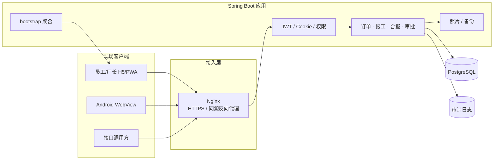
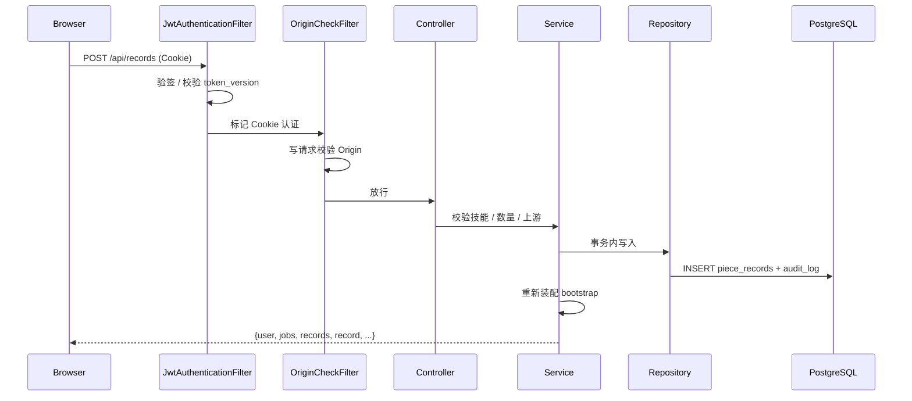

# 01 · 系统架构

## 1. 背景

计件通是一套面向 50 人以内小型工厂的计件生产管理系统，目前在一家 17 人左右的工厂使用，覆盖写真和亚克力两条产线。

它解决三个现场问题：

- 员工报工要快：扫码 → 选工序 → 报工成功；
- 多人合报要算得清：开组、加入、结束平分；
- 厂长看到的是实际生产进度，不是事后补出来的表。

## 2. 总体结构



## 3. 模块边界

```text
com.jitong.core
├─ common       统一异常、ID、时间格式、存储路径
├─ config       Security、OpenAPI、配置属性
├─ security     JWT、Cookie、登录限流、认证
├─ employee     员工、技能、权限、视图装配
├─ catalog      工序字典、路线模板
├─ job          订单、工序快照、订单服务
├─ group        合报状态机、结算、状态事件
├─ report       报工、冲销、审批
├─ bootstrap    前端首屏聚合响应
├─ settings     重复报工窗口、容差
├─ audit        审计日志
├─ photo        现场照片
├─ seed         演示数据 / 初始管理员
└─ system       健康检查、初始账号、前端入口、清库
```

按业务分包，而不是按 `controller/service/mapper` 分层。合报规则集中在 `group`，报工规则集中在 `report`，订单规则集中在 `job`，改动边界清晰。

## 4. 请求链路



## 5. 部署拓扑

```text
手机/电脑
   │ HTTPS
   ▼
 Nginx（443，证书，同源反向代理）
   │
   ▼
 Spring Boot（8080，单实例）
   ├─ PostgreSQL（5432，生产库）
   ├─ data/photos（现场照片）
   └─ data/backups（清库/发布前备份）
```

- Nginx 负责 HTTPS、域名、反向代理和访问日志；
- Spring Boot 负责认证、业务、静态前端和接口；
- PostgreSQL 负责生产数据；
- 照片和备份放本地卷，定期同步到备份盘。

## 6. 设计原则

1. **服务端校验**：技能、数量、订单状态、权限都不能只靠前端；
2. **快照优先**：订单保存路线快照，历史订单不受路线修改影响；
3. **状态显式**：合报有状态机和事件表，不靠布尔开关；
4. **幂等兜底**：报工和结算都有唯一键，网络重试不会重复记账；
5. **可追溯**：关键操作写审计，作废不物理删除；
6. **可回滚**：数据库有备份，发布前先备份，应用可回退上一版；
7. **不过度设计**：单厂单实例，先把规则和可维护性做好。

## 7. 可用性与回滚

- 应用无状态（会话在 JWT），可以重启/替换 jar；
- 数据库是唯一状态源，发布前做 `pg_dump`；
- 照片和备份在独立卷，不随容器重建丢失；
- 发布失败：回退上一版 jar，必要时恢复数据库备份；
- 数据清理：清空生产数据前自动导出 JSON 备份。

## 8. 相关文档

- [数据库设计](02-数据库设计.md)
- [接口清单](03-接口清单.md)
- [JWT 与权限设计](04-JWT与权限设计.md)
- [合报状态机](05-合报状态机.md)
- [前端对接与联调](06-前端对接与联调.md)
- [测试与验收](08-测试与验收.md)
- [生产部署](09-生产部署.md)
