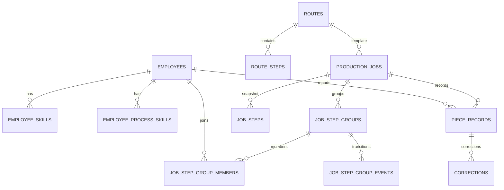

# 02 · 数据库设计

## 1. ER 图



## 2. 表清单

| 表 | 作用 | 关键约束 |
| --- | --- | --- |
| `employees` | 员工/厂长账号 | `employee_no` 唯一；`is_admin`、`can_create_job`、`active` |
| `employee_skills` | 兼容权限：产线 + 第几道 | `(employee_id,line,step_no)` 唯一 |
| `employee_process_skills` | 新版权限：工序名称 | `(employee_id,process_name)` 唯一 |
| `skill_catalog` | 工序字典 | `name` 主键 |
| `routes` | 路线模板 | `route_key` 唯一 |
| `route_steps` | 路线工序 | `(route_id,step_no)` 唯一 |
| `production_jobs` | 订单 | `order_no`、`qr_token` 唯一；`version` 乐观锁 |
| `job_steps` | 订单工序快照 | `(job_id,step_no)` 唯一 |
| `job_step_groups` | 合报组 | `(job_id,step_no)` 唯一；`status`、`version` |
| `job_step_group_members` | 合报参与人 | `(group_id,employee_id)` 唯一 |
| `job_step_group_events` | 合报状态迁移事件 | 只追加 |
| `piece_records` | 报工记录 | `idempotency_key` 唯一；`status` |
| `corrections` | 冲销申请 | 同一记录同时最多一条 pending（业务校验） |
| `audit_log` | 审计 | 只追加 |
| `settings` | 系统参数 | `setting_key` 主键 |

## 3. 关键字段说明

### 3.1 `production_jobs`

| 字段 | 说明 |
| --- | --- |
| `route_key` | 下单时选择的路线键；历史订单可空 |
| `planned_qty` | 订单计划量；当前建单为 0，以 `meters` 为主要数量 |
| `meters` | 米数/数量；自动报工取 `meters`，为 0 时回退 `planned_qty` |
| `unit` | `m²` / `件` / `套` / `块` |
| `status` | `active` / `completed` / `void` |
| `version` | JPA 乐观锁，防止并发改单覆盖 |

### 3.2 `job_steps`

订单创建时把 `route_steps` 复制为 `job_steps`，并写入 `step_name`。

- 管理员之后修改路线，不影响历史订单；
- 报工校验优先按 `step_name` 查 `employee_process_skills`；
- 旧订单 `step_name` 为空时，回退到 `employee_skills(line, step_no)`。

### 3.3 `job_step_groups`

| 字段 | 说明 |
| --- | --- |
| `status` | `open` / `settling` / `closed` / `cancelled` |
| `total_qty` | 开组时的订单数量快照，结算按它平分 |
| `version` | 乐观锁；并发结束合报时只有一个成功 |
| `close_reason` | 手动结束、下一道开始、完成订单等 |

### 3.4 `piece_records`

| 字段 | 说明 |
| --- | --- |
| `qty` | `NUMERIC(12,3)`，避免浮点误差 |
| `status` | `valid` / `pending` / `void` |
| `idempotency_key` | 客户端键或服务端生成；唯一索引 |
| `source` | `scan` / `auto` / `group` |
| `group_id` | 合报结算生成的记录可追溯到组 |
| `approved_by/at` | 超量待确认的审批信息 |

### 3.5 `job_step_group_events`

每次状态迁移都追加一条：

```text
from_state, to_state, action, actor_id, reason, created_at
```

它解决两个问题：

- 现场排障：这个组什么时候、被谁、因为什么结束；
- 排障与复盘：状态机不是口头描述，而是有数据佐证。

## 4. 索引

| 索引 | 用途 |
| --- | --- |
| `idx_piece_job_step(job_id,step_no,status)` | 工序完成量、上游校验 |
| `idx_piece_employee_time(employee_id,created_at)` | 个人产量/记录 |
| `idx_piece_line_time(line,created_at)` | 产线统计 |
| `idx_corrections_status(status)` | 待审批列表 |
| `idx_group_events_group(group_id,created_at)` | 合报追溯 |
| `idx_jobs_status_created(status,created_at)` | 首屏进行中订单 |
| `idx_audit_created(created_at)` | 审计查询 |

## 5. 设计选择

| 设计 | 选择 | 原因 |
| --- | --- | --- |
| 主键 | 文本 ID | 业务 ID 可读，接口直接暴露 |
| 关联表 | 代理主键 + 唯一约束 | JPA 映射简单，语义不变 |
| 数值 | `NUMERIC(12,3)` | 数量/米数避免二进制浮点误差 |
| 布尔 | `BOOLEAN` | 可读性、PostgreSQL 原生支持 |
| 时间 | `TIMESTAMP WITH TIME ZONE` | 时区明确，跨端一致 |
| 清库备份 | JSON 逻辑备份 | H2/PostgreSQL 通用 |
| 建表 | Flyway | 版本化、可审计、可规划 |

> 接口层输出 camelCase 和小写状态字符串，前端不直接依赖数据库字段名。

## 6. 数据量与容量

当前单厂规模：

- 员工 < 50；
- 订单 < 1 万/年；
- 报工 < 20 万/年；
- 合报组 < 5 万/年。

这些量级下，单表索引 + 单实例 PostgreSQL 足够。首屏 bootstrap 限制：

- 订单：近 45 天或进行中；
- 报工：近 45 天或进行中订单，最多 2 万条；
- 冲销：近 45 天，最多 1000 条。

如果未来多工厂，再按 `factory_id` 分区，而不是现在过度设计。

## 7. 数据导入与升级

1. 先建库并跑 Flyway；
2. 导入员工、技能、路线（字典类，量小）；
3. 导入订单与工序快照（保留原 ID）；
4. 导入报工、冲销、合报组，保留 `created_at`；
5. 校对总量：按订单/工序/员工三个维度对账；
6. 旧 PIN 哈希可直接复用（PBKDF2 格式兼容）。

导入前先备份源库；导入后至少核对订单数、报工总量、每人产量和合报组数量。
