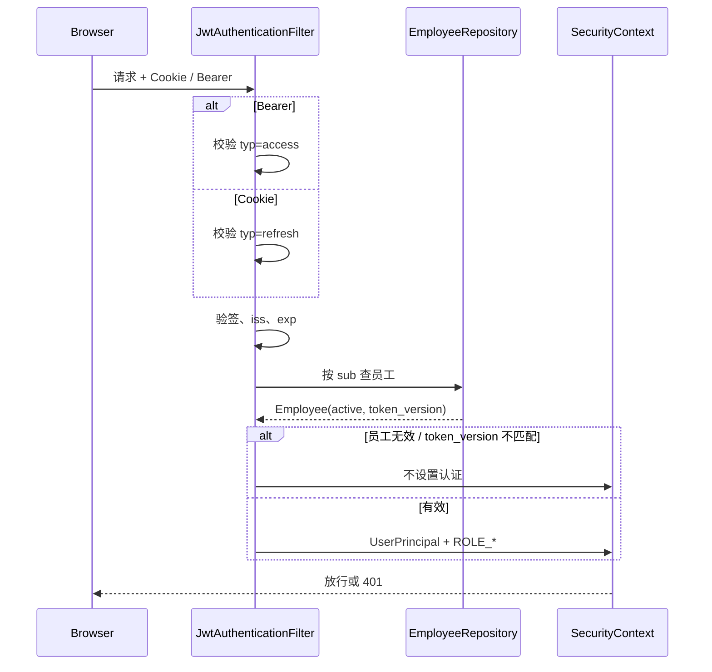

# 04 · JWT 与权限设计

## 1. 为什么不是“只发一个 JWT”

现有 H5/PWA 使用 `fetch` + `credentials: same-origin`，浏览器会自动带 Cookie。  
如果把 Access Token 放在 `localStorage`，需要改前端；如果只发 30 分钟 Access Token 到 Cookie，用户体验会变成“每天重新登录”。

所以采用双令牌：

```text
Access Token  : 30 分钟，返回 JSON，供接口调用 / 前端可选使用
Refresh Token : 30 天，HttpOnly Cookie，浏览器自动携带
```

- 前端不改：继续用 Cookie；
- 接口调用方：用 `Authorization: Bearer <access>`；
- 浏览器端 Access Token 过期也不影响使用，因为 Cookie 仍然有效；
- Cookie 临近过期时，服务端自动续期（滑动窗口）。

## 2. Token 内容

```json
{
  "iss": "jitong-spring-core",
  "sub": "E007",
  "jti": "uuid",
  "iat": 1760000000,
  "exp": 1760001800,
  "typ": "access",
  "ver": 3,
  "name": "员工07"
}
```

| Claim | 用途 |
| --- | --- |
| `sub` | 员工 ID |
| `typ` | `access` / `refresh`，防止拿 Refresh 当 Bearer 用 |
| `ver` | 员工 `token_version`，改密/停用/退出时递增，旧 token 全部失效 |
| `jti` | 预留：后续可接 Redis 黑名单 |
| `iss` | 固定签发方，解析时校验 |

签名算法：HS256。密钥从 `JITONG_JWT_SECRET` 读取，至少 32 字节。

## 3. 请求认证流程



过滤器不会因为 token 无效而抛 500；它只是“不认证”，由 Spring Security 的 `AuthenticationEntryPoint` 返回统一 401 JSON。

## 4. RBAC 模型

系统只有三类“能力”，不是复杂的 RBAC 表：

| 能力 | 来源 | Spring Authority |
| --- | --- | --- |
| 登录员工 | `employees.active=1` | `ROLE_EMPLOYEE` |
| 厂长 | `employees.is_admin=1` | `ROLE_ADMIN` |
| 建单人 | `employees.can_create_job=1` | `ROLE_CREATOR` |

权限变更实时生效：每次请求都从数据库加载员工，而不是完全信任 JWT 里的角色。  
代价是每请求一次员工查询；单厂规模完全可接受，也避免“授权后必须重新登录”。

### 接口权限矩阵

| 接口组 | 员工 | 建单人 | 厂长 |
| --- | --- | --- | --- |
| 登录、bootstrap、我的记录 | ✅ | ✅ | ✅ |
| 手工报工 / 自动报工 | 需工序技能 | 需工序技能 | 厂长技能全通过 |
| 新建订单 | ❌ | ✅ | ❌ |
| 改单 / 作废 | ❌ | ❌ | ✅ |
| 完成订单 / 结束合报 | 仅建单人本人订单 | 仅本人订单 | ✅ |
| 审批报工 / 冲销 | ❌ | ❌ | ✅ |
| 员工 / 技能 / 路线 / 清库 / 审计 | ❌ | ❌ | ✅ |

> “厂长技能全通过”指 `canReport` 对 admin 直接返回 true，方便现场补录；但建单仍按产品规则禁止。

## 5. Cookie 安全

| 属性 | 值 | 说明 |
| --- | --- | --- |
| `HttpOnly` | true | JS 读不到，降低 XSS 窃取 |
| `SameSite` | `Lax` | 跨站 POST 不带 Cookie |
| `Secure` | 生产 true | HTTPS 下传输 |
| `Path` | `/` | 与前端同源 |
| `Max-Age` | 30 天 | 与 Refresh 一致 |

### 没有 CSRF Token 怎么办

现有前端没有 CSRF Token，直接关掉 CSRF 有风险。系统的补充措施：

1. `SameSite=Lax`；
2. 写请求校验 `Origin`：同源放行，跨源仅允许白名单；
3. 所有写接口要求 `application/json`（简单表单无法伪造）；
4. `GET` 不产生副作用。

这不能替代标准 CSRF Token，但在“不改前端”的约束下是合理折中。未来可加 `/api/csrf` 并把 token 放进前端请求头。

## 6. 登录限流

- 维度：账号 + 客户端 IP；
- 窗口：5 分钟；
- 阈值：20 次失败（可配置）；
- 超限：`429 too_many_attempts`；
- 成功登录清零。

当前是进程内 `ConcurrentHashMap`，单实例够用；多实例时替换成 Redis：

```text
KEY login:fail:<account>:<ip>  INCR + EXPIRE
```

## 7. 退出 / 改密 / 停用

| 操作 | 行为 |
| --- | --- |
| 退出 | `token_version++`，清 Cookie；该员工所有设备立即失效 |
| 改密 | 校验旧密码，更新 PBKDF2，`token_version++`，给当前设备发新 Refresh Cookie |
| 停用 | `active=false`，`token_version++`；过滤器拒绝 |
| 重置 PIN | 管理员操作，`token_version++`；旧会话失效 |

`token_version` 是“全设备下线”的简洁实现；如果未来需要单设备下线，再加 `jti` 黑名单表。

## 8. 密码存储

PIN 存储格式：

```text
pbkdf2_sha256$160000$<salt base64url>$<digest base64url>
```

- PBKDF2-HMAC-SHA256；
- 160,000 次；
- 16 字节随机盐；
- 256 位输出；
- 常数时间比较。

兼容历史 PIN 哈希，升级后不需要强制全员重置密码。测试里有一组由历史实现生成的哈希做兼容校验。

## 9. 生产配置清单

```bash
JITONG_JWT_SECRET='至少32字节随机值，不要用仓库默认值'
JITONG_COOKIE_SECURE=true
JITONG_SHOW_ACCOUNTS=false
JITONG_SEED_DEMO=false
JITONG_ADMIN_PASSWORD='强密码'
JITONG_CORS_ORIGINS=''          # 同源部署时留空
```

- 反向代理必须传递 `X-Forwarded-Proto` / `X-Forwarded-For`；
- 应用配置 `server.forward-headers-strategy=framework`；
- 如果前后端分域部署：Cookie 需要 `SameSite=None; Secure`，并配置 CORS 白名单；
- 生产不要暴露 H2 Console（本项目也未开启）。
