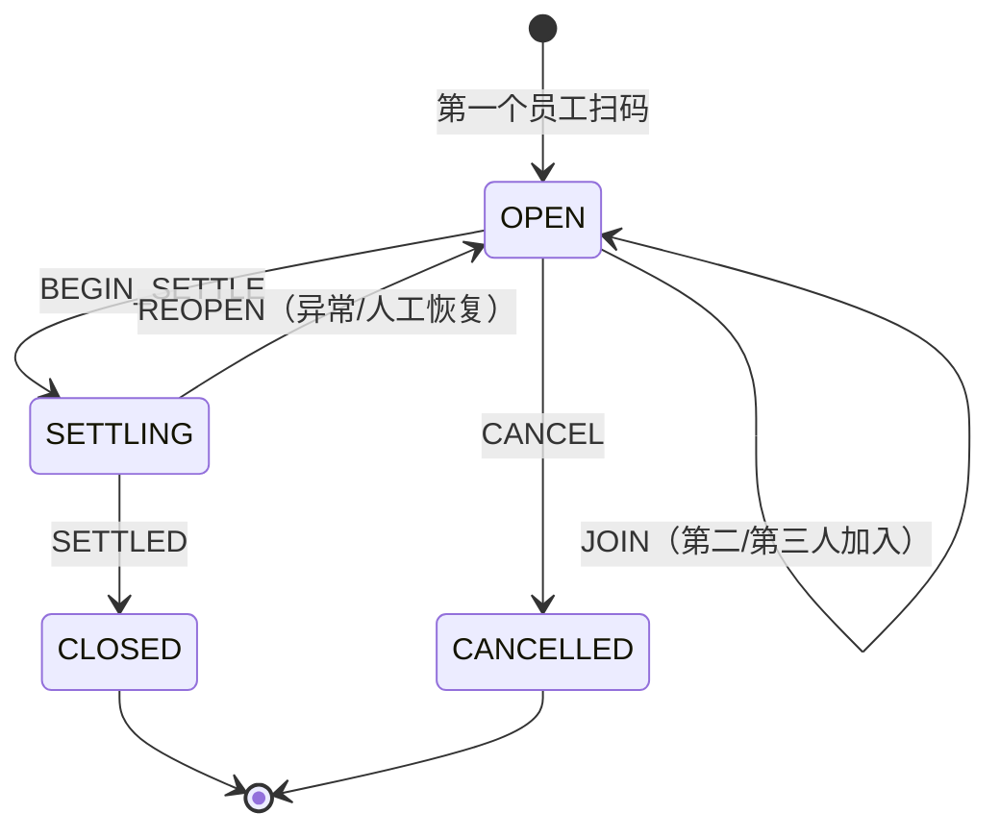
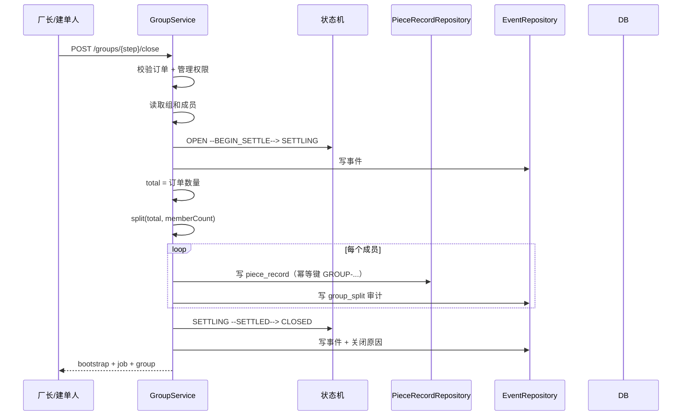

# 05 · 合报状态机

## 1. 业务背景

写真过板、写真亚克力加工、激光切割这些工序，经常 2～3 个人一起做。

第一版按“谁扫码给谁记一份”做，三个人扫同一道，数量被算成三倍。  
现在的规则是：

```text
第一个员工扫码 → 开组
后续员工扫码   → 加入
下一道工序开始 → 自动结束上一道
厂长完成订单   → 结束最后一道
结束时按实际人数平分，最后一人补小数差额
```

加入阶段**不写正式产量**，结束的时候才一次性生成每人的报工记录。

## 2. 状态定义

| 状态 | 含义 | 可执行动作 |
| --- | --- | --- |
| `OPEN` | 已开组，可继续加入 | `JOIN`、`BEGIN_SETTLE`、`CANCEL` |
| `SETTLING` | 结算事务中（仅事务内可见） | `SETTLED`、`REOPEN` |
| `CLOSED` | 已结算，终态 | 无 |
| `CANCELLED` | 已取消，终态 | 无 |



## 3. 迁移表

| From | Action | To | 触发 |
| --- | --- | --- | --- |
| OPEN | JOIN | OPEN | 员工扫码加入 |
| OPEN | BEGIN_SETTLE | SETTLING | 手动结束 / 下一道开始 / 完成订单 |
| SETTLING | SETTLED | CLOSED | 分摊记录全部写入成功 |
| SETTLING | REOPEN | OPEN | 结算失败回滚/人工恢复（当前由事务回滚兜底） |
| OPEN | CANCEL | CANCELLED | 订单作废 |
| CLOSED | * | 拒绝 | 终态 |
| CANCELLED | * | 拒绝 | 终态 |

非法迁移在 `GroupStateMachine.next()` 直接抛 `IllegalStateException`，Service 层不会继续写库。

## 4. 结束合报时序



任何一个成员写入失败，整个事务回滚：

- 组回到 `OPEN`；
- 不会出现“只给一半人记了产量”；
- 不需要定时补偿任务。

## 5. 分摊算法

```text
per = round(total / count, 3)
前 count-1 人 = per
最后 1 人 = round(total - per * (count-1), 3)
```

例：

```text
total = 100, count = 3
per = 33.333
结果 = [33.333, 33.333, 33.334]
sum = 100.000
```

实现：`SettlementCalculator`，使用 `BigDecimal` + `HALF_UP`，避免 `double` 误差。

## 6. 数量从哪里来

开组时把订单数量写入 `job_step_groups.total_qty`，用于 UI 展示。

结束时按订单当前数量结算：

```text
meters > 0 ? meters : planned_qty
```

原因：

- 合报组未产生正式报工时，厂长仍可能改米数；
- 结算应以“结束时的订单数量”为准；
- 一旦已有报工，改单接口会拒绝修改米数，避免结算口径漂移。

## 7. 自动结束时机

| 场景 | 行为 |
| --- | --- |
| 员工报下一道工序 | `closeOpenGroupsBefore(job, stepNo)` 结束所有更低工序的 OPEN 组 |
| 完成订单 | `closeAllOpenGroups(job)` 结束所有 OPEN 组，再检查每道工序是否有有效报工 |
| 手动结束 | 厂长/建单人调用 close 接口 |
| 订单作废 | 将 OPEN 组置为 `CANCELLED`，不生成报工记录 |

## 8. 并发与幂等

- `job_step_groups.version` 乐观锁：两个厂长同时点“结束”，只有一个成功，另一个收到 `409 concurrent_update`；
- 每个成员记录使用 `GROUP-<groupId>-<employeeId>` 幂等键：重复结算不会重复记账；
- `piece_records.idempotency_key` 唯一索引兜底；
- 成员唯一约束 `(group_id, employee_id)`：同一人重复扫码不会重复加入；
- 重复 close 已关闭组：直接返回当前组，不报错（幂等）。

## 9. 边界情况

| 情况 | 处理 |
| --- | --- |
| 组里没有成员 | 直接置 CLOSED，不生成记录 |
| 订单数量为 0 | 每人 0.000，仍生成记录（保留参与事实） |
| 成员中途被移除 | 只允许 OPEN 状态移除；已结算不能改 |
| 组已 CLOSED 再次 close | 返回当前组，幂等 |
| 组 CANCELLED 后 close | 400 `group_cancelled` |
| 结算时数据库异常 | 事务回滚，组保持 OPEN，记录不落库 |
| 两人同时加入 | 成员唯一约束 + 事务，最终只有一条成员记录 |

## 10. 事件表

`job_step_group_events` 只追加，不更新：

| 字段 | 说明 |
| --- | --- |
| `from_state` / `to_state` | 迁移前后 |
| `action` | `OPEN` / `JOIN` / `BEGIN_SETTLE` / `SETTLED` / `CANCEL` |
| `actor_id` | 谁触发 |
| `reason` | 手动结束、下一道开始、完成订单等 |
| `created_at` | 时间 |

它同时服务于：

- 现场排障：为什么这个组被结束、谁结束的；
- 审计：合报不是“黑盒平分”；
- 复盘：状态机有数据落点，不是 PPT。

## 11. 设计小结

- 合报不是布尔开关，而是有合法迁移规则的状态机；
- 结算在单个数据库事务内完成，失败整体回滚；
- 每个成员记录有稳定幂等键，重复结算不会重复记账；
- 每次状态变化都写入事件表，现场排障和审计都有据可查。
